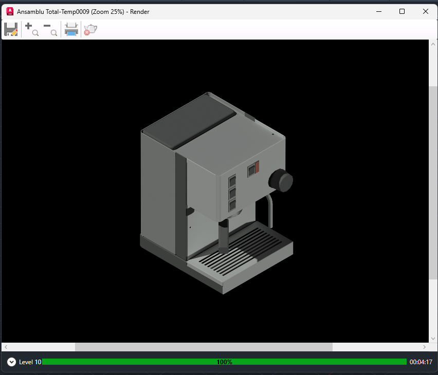
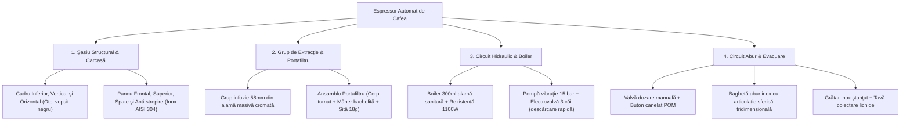
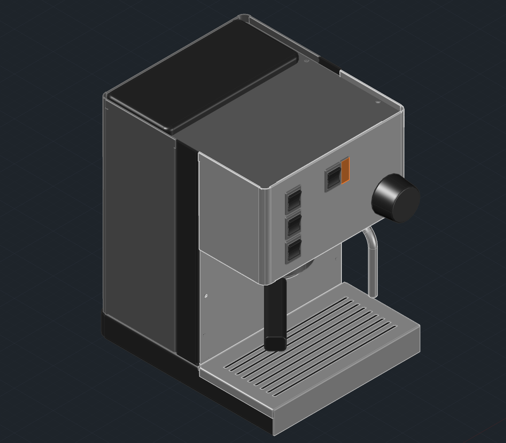
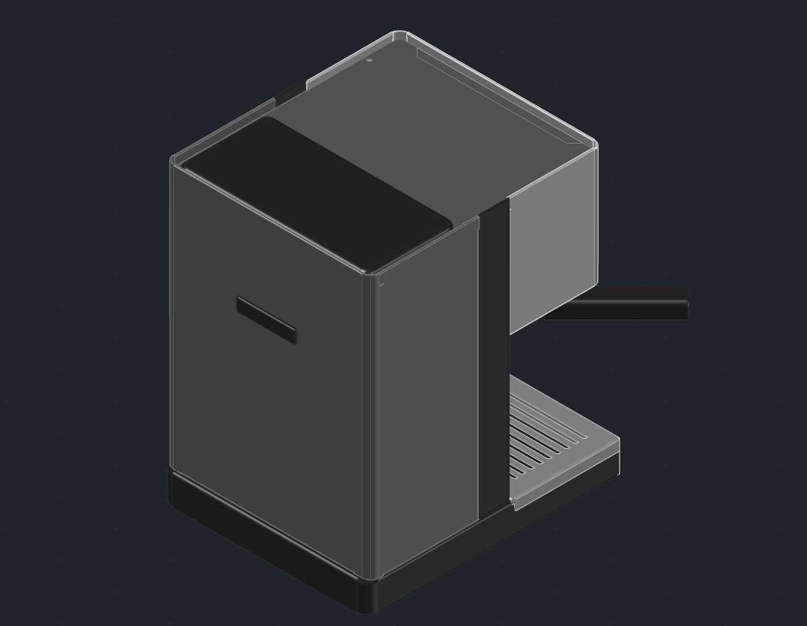
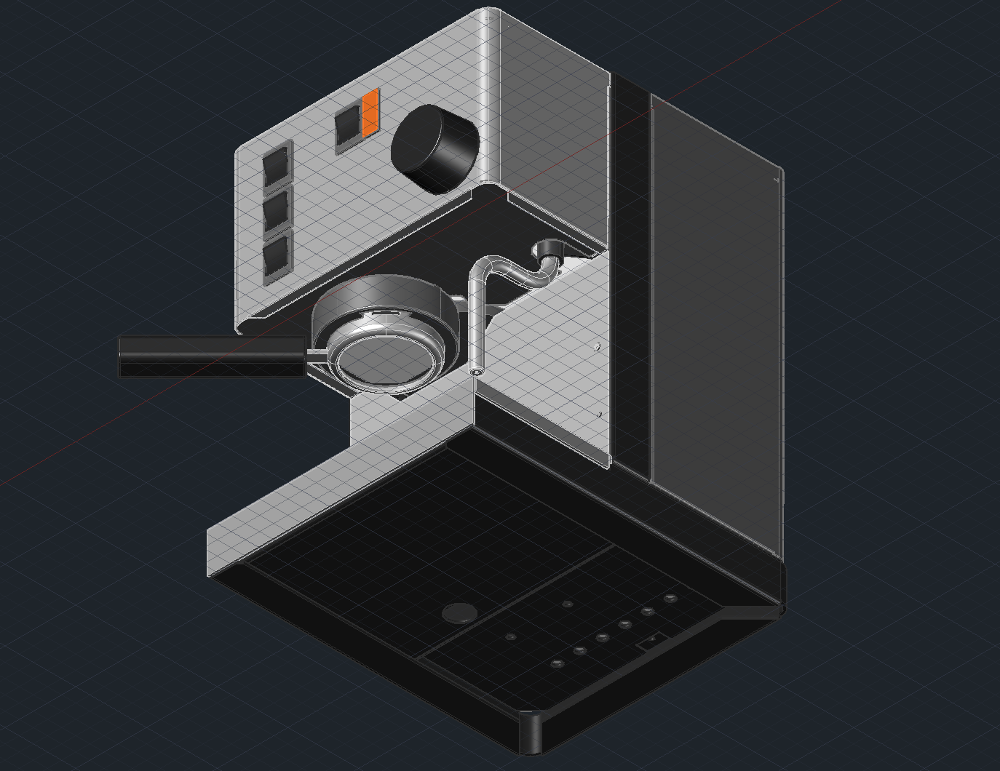
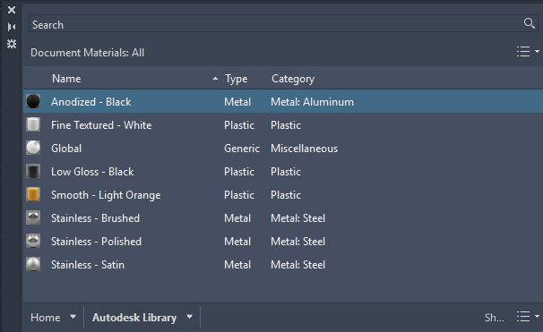

# Espressor Automat de Cafea — Modelare 3D CAD & Documentație Tehnică

[](https://www.autodesk.com/products/autocad)
[](cad/native/Ansamblu_Total.dwg)
[](documentation/Documentatie%20-%20Flueraru%20Alexandru%20Achille%20Gr.161.pdf)
[](documentation/memoriu_tehnic.md)
[](https://github.com)
[](LICENSE)

> **Proiect complet de inginerie mecanică și modelare grafică 3D parametrică realizat de la zero în Autodesk AutoCAD.**  
> Proiectul materializează proiectarea detaliată a unui espressor de cafea cu performanțe din clasa *prosumer*, inspirat de etalonul industrial **Rancilio Silvia**, incluzând arhitectura completă de șasiu, grup de extracție profesional de 58 mm, boiler termic cu inerție ridicată, circuit hidraulic de înaltă presiune, carcasă din oțel inoxidabil, documentație tehnică oficială de 97 de pagini și planșe tehnice complete de execuție în spațiul *Paper Space*.

---

## Imagine Principală / Randare Fotorealistă (Hero View)

<p align="center">
  
  <br>
  <em>Figura 1: Randarea finală a ansamblului complet al espressorului — Generată cu motorul nativ AutoCAD Render (Calitate Level 10, Iluminare fizică și texturare pe straturi, Fundal Black Ambient).</em>
</p>

---

## Prezentare Generală a Proiectului

Espressorul automat este proiectat pentru a furniza o extracție optimă a cafelei de specialitate la o temperatură stabilă de $93^\circ\text{C}$ și o presiune constantă de $9\text{ bar}$. Ansamblul integrează peste 24 de componente geometrice unice, dezvoltate progresiv de la schițe 2D cotate (`Drafting & Annotation`) până la solide tridimensionale complexe (`3D Solids`), verificate împotriva oricăror interferențe spațiale.

### Puncte Forte ale Proiectării:
* **Modelare 100% de la zero:** Fără componente importate gata făcute; fiecare șurub, flanșă, îmbinare și racord este modelat geometric pe bază de cote riguroase.
* **Trecere controlată 2D -> 3D:** Profile închise (polilinii, regiuni) transformate prin extrudare (`EXTRUDE`), revoluție (`REVOLVE`) și măturare pe trasee spațiale 3D (`SWEEP`).
* **Documentație de nivel industrial:** Generare automată de vederi ortogonale și izometrice în spațiul *Paper Space* (scara standardizată 1:5), cotare ISO și cartuș universitar.
* **Documentație Tehnică Completă:** Raport oficial extins de 97 de pagini redactat riguros, cu detalii constructive și de asamblare pas-cu-pas.
* **Materiale și Texturi Fizice:** Asignare de materiale industriale (oțel satinat, oțel lustruit, aluminiu anodizat, bachelită termoizolantă și polimeri alimentari fără BPA).

---

## Specificații Tehnice Principale

| Parametru Tehnic | Valoare Nominală | Observații Inginerești / Justificare |
| :--- | :--- | :--- |
| **Dimensiuni de Gabarit (L x l x h)** | **$235 \times 290 \times 340\text{ mm}$** | Format compact optimizat ergonomic pentru blaturi de bucătărie sau bar |
| **Masă Totală Estimată** | **$\approx 14.0\text{ kg}$** | Centru de masă coborât pe șasiul de oțel pentru manevrarea fără balans a portafiltrului |
| **Presiune Pompă Hidraulică** | **$15\text{ bar}$ max** (reglată la $9\text{ bar}$ la grup) | Pompă cu piston oscilant (tip ULKA EP5) cuplată cu supapă de suprapresiune (OPV) |
| **Capacitate Rezervor Apă** | **$2.0\text{ Litri}$** | Polimer alimentar SAN / Tritan transparent, detașabil prin culisare verticală |
| **Boiler / Cazan Termic** | **$300\text{ ml}$ — Alamă CW510L Lead-Free** | Turnare de precizie; alama asigură o capacitate calorică și o stabilitate termică de top |
| **Element Încălzitor (Rezistență)** | **$1100\text{ W} - 1450\text{ W}$ ($230\text{V} / 50\text{Hz}$)** | Incoloy 800 rezistent la depuneri de calcar; timp de încălzire la $93^\circ\text{C} < 98\text{ sec}$ |
| **Standard Grup Extracție** | **$\mathbf{\Phi 58\text{ mm}}$ Profesional** | Alamă forjată masivă placată cu crom, compatibilitate portafiltru industrial E61 / Silvia |
| **Sistem Producere Abur** | **Baghetă Inox cu Articulație $360^\circ$** | Teavă fără sudură din oțel inoxidabil AISI 304, vârf conic cu micro-orificiu pentru microspumă |
| **Material Carcasă Exterioară** | **Oțel Inoxidabil AISI 304 (Satinat)** | Rezistență absolută la coroziune sub acțiunea aburului; igienic și ușor de curățat |
| **Material Șasiu Structural** | **Oțel laminat 1.5 mm (Vopsit electrostatic)** | Tratat anticoroziune, finisaj `Anodized - Black` cu rigiditate torsională ridicată |

---

## Prezentarea Subansamblurilor Cheie



### 1. Unitatea de Infuzie & Grupul de Extracție (58 mm)
* **Grupul masiv de alamă:** Proiectat dintr-un bloc masiv de alamă cromată direct fixat pe boiler, eliminând pierderile de căldură între cazan și patul de cafea.
* **Portfiltrul Ergonomic:** Corp forjat cu ghidaj dublu de curgere și sistem de zăvorâre tip baionetă la $45^\circ$. Mânerul este optimizat ergonomic din polimer fenolic (bachelită) termoizolant, asamblat prin tijă filetată M10 din oțel.
* **Sită de extracție:** Profilată cu micro-perforații conice pentru reținerea unei doze duble de 18 grame de măcinătură la presiuni de $9\text{ bar}$.

### 2. Circuitul Hidraulic, Boilerul & Electrovalva cu 3 Căi
* **Boiler cu inerție termică:** Volum de $300\text{ ml}$ capabil să susțină extracții consecutive fără fluctuații termice mai mari de $\pm 1^\circ\text{C}$.
* **Electrovalva de descărcare (3-way Solenoid Valve):** La întreruperea comenzii de extracție, electrovalva redirecționează instantaneu contrapresiunea din portafiltru către tava de scurgere, uscând pucul de cafea și prevenind stropirea la deblocare.
* **Trasee de fluide:** Tevi de cupru recopt CW024A calibrate hidraulic și racorduri sertizate de înaltă presiune.

### 3. Circuitul de Abur și Distribuitorul de Apă Caldă
* **Valva de abur de precizie:** Modelată cu scaun conic și etanșare cu garnitură de teflon (PTFE) rezistentă la $180^\circ\text{C}$.
* **Țeava de abur (Steam Wand):** Măturată 3D (`SWEEP`) pe o curbă ergonomică, dotată cu articulație sferică pentru orientare liberă în cana de frotare lapte.
* **Butonul de reglaj:** Prevăzut cu striații radiale pentru o aderență excelentă chiar și cu mâinile umede.

### 4. Șasiul Structural și Carcasarea Exterioară
* **Baza structurală:** Format din trei elemente independente (Cadru Inferior, Cadru Vertical și Cadru Orizontal) asamblate cu toleranțe de $\pm 0.1\text{ mm}$, garantând alinierea perfectă a carcasei exterioare.
* **Panoul frontal & interfața:** Integrează lăcașurile pentru cele 3 comutatoare basculante robuste (Pornire Generală, Infuzie Cafea, Mod Abur) și lampa martor chihlimbarie.
* **Tava și grătarul de scurgere:** Suprafață decupată laser din tablă de inox de 1.2 mm, detașabilă rapid pentru golire și igienizare.

---

## Galerie de Randări și Detalii Constructive

| Vedere Izometrică Față (Sud-Vest) | Vedere Izometrică Spate (Nord-Vest) |
| :---: | :---: |
|  |  |
| *Panou frontal, comutatoare, grup și portafiltru* | *Acces rezervor apă, decupaje ventilare și racord rețea* |

| Detaliu Subansamblu Bază & Șasiu | Ierarhia Materialelor Industriale |
| :---: | :---: |
|  |  |
| *Cadrul structural negru, tava și grătarul de drenaj* | *Asignarea oțelului satinat, lustruit, alamei și polimerilor* |

---

## Arhitectura Repository-ului (File Tree)

Structura proiectului este organizată conform celor mai bune practici din industria ingineriei mecanice și a standardelor deschise de control al versiunilor:

```
├── README.md                           # Studiul de caz principal și prezentarea portofoliului
├── .gitignore                          # Excluderi fișiere temporare, de lock (.dwl/.dwl2) și cache CAD
├── .gitattributes                      # Configurare atribute binare (-text) pentru DWG/STEP/PDF
├── LICENSE                             # Licență MIT
├── cad/
│   ├── native/                         # Fișiere sursă CAD originale AutoCAD (.dwg)
│   │   ├── Ansamblu_Total.dwg          # Modelul 3D complet integrat al espressorului
│   │   └── piese_si_subansambluri/     # Toate cele 24 de piese și subansambluri (schițe 2D + solide 3D)
│   │       ├── Ansamblu Cadru/         # Cadru inferior, vertical și traversă orizontală
│   │       ├── Ansamblu panou frontal/ # Panou frontal, carcasă întrerupător, buton, lampă
│   │       ├── Ansamblu Portafiltru/   # Corp portafiltru, mâner bachelită, sită 18g
│   │       ├── Ansamblu Abur/          # Teavă abur 3D măturată, valvă alamă
│   │       ├── Grup extractie/         # Corp grup infuzie 58 mm
│   │       ├── Gratar Scurgere/        # Grătar decupat și tavă
│   │       ├── Rezervor/ & Capac/      # Rezervor apă 2L și capac etanș
│   │       └── Panou Spate/ & Superior/# Învelitori din tablă inox satinat
│   └── neutral_exports/                # Formate neutre pentru compatibilitate CAD/CAM & Printare 3D
│       ├── README.md                   # Ghid de export și standarde (ISO 10303, STL)
│       ├── espressor_ansamblu_complet.step # Format neutru STEP AP214 / AP242 (B-Rep solids)
│       └── espressor_ansamblu_complet.stl  # Mesh triunghiular de înaltă rezoluție pentru printare 3D
├── drawings_pdf/                       # Planșe tehnice vectoriale cotate, vederi ortogonale și secțiuni
│   └── Ansamblu_Total_Plansa_Tehnica.pdf # Planșă completă din Paper Space la scară 1:5 cu indicator
├── renders/                            # Imagini de înaltă rezoluție și randări foto-realiste
│   ├── hero_render.png                 # Randare principală de înaltă definiție (Level 10)
│   ├── isometric_front.png             # Perspectivă izometrică față
│   ├── isometric_rear.png              # Perspectivă izometrică spate
│   ├── detail_lower_assembly.png       # Detaliu cadru structural și zonă drenaj
│   └── materials_hierarchy.png         # Paleta de texturi și straturi de materiale
└── documentation/
    ├── BOM_espressor.csv               # Bill of Materials complet (24 componente, materiale, procedeu)
    ├── Documentatie - Flueraru Alexandru Achille Gr.161.pdf # Raportul tehnic oficial complet (97 pagini)
    └── memoriu_tehnic.md               # Memoriu tehnic detaliat, calcule termice și verificare de presiune
```

---

## Bill of Materials (BOM) — Componente Esențiale

Extras din documentul complet [`documentation/BOM_espressor.csv`](documentation/BOM_espressor.csv):

| Nr. | Componentă | Cant. | Material Utilizat | Metodă Fabricație | Rol Funcțional Principal |
| :-: | :--- | :-: | :--- | :--- | :--- |
| **01** | Cadru Inferior (Șasiu bază) | 1 | Oțel Fe P04 / Aluminiu | Debitare laser & ambutisare | Șasiu portant pentru pompă, boiler și tavă |
| **02** | Cadru Vertical (Coloană) | 1 | Oțel structural 1.5 mm | Debitare CNC & îndoire pe abkant | Rigidizare structurală și suport panou electric |
| **04** | Panou Frontal | 1 | Inox AISI 304 satinat (1.2 mm) | Decupare laser CNC & ștanțare | Interfață comenzi, montaj comutatoare și grup |
| **08** | Grătar Scurgere | 1 | Inox AISI 304 lustruit (1.2 mm) | Ștanțare fante eliptice & debavurare | Suport cești și drenaj lichide în tavă |
| **09** | Rezervor Apă (2.0 L) | 1 | Polimer SAN / Tritan BPA-Free | Injecție mase plastice | Stocare apă curată cu racord etanș |
| **11** | Boiler Termic (300 ml) | 1 | Alamă sanitara CW510L Lead-Free | Turnare de precizie & așchiere CNC | Încălzire apă la 93°C și generare abur |
| **12** | Rezistență Electrică (1100W) | 1 | Incoloy 800 + Flanșă alamă | Formare tubulară & lipire tare | Conversie electrotermică de înaltă eficiență |
| **13** | Grup Extracție (58 mm) | 1 | Alamă masivă forjată & cromată | Forjare la cald & frezare 5 axe | Retenție termică și cuplaj etanș portafiltru |
| **14** | Corp Portafiltru | 1 | Alamă cromată calitate grea | Forjare & strunjire CNC | Cameră de presiune 9 bar pentru sită |
| **15** | Mâner Portafiltru | 1 | Bachelită (Rășină fenolică) | Injecție plastic & filet M10 | Manevrare ergonomică termoizolată |
| **17** | Valvă Dozare Abur | 1 | Alamă forjată CW510L | Prelucrare strung CNC | Control progresiv al debitului de abur |
| **18** | Țeavă Abur (Steam Wand) | 1 | Inox AISI 304 fără sudură | Îndoire 3D pe dorn & articulație sferică | Texturare spumă lapte la mișcare pe 3 axe |
| **20** | Pompă cu Vibrație (15 bar) | 1 | Corp PA66 + Piston inox | Subansamblu standard (ex: ULKA EP5) | Generare presiune hidraulică nominală |
| **21** | Electrovalvă 3 Căi (OPV) | 1 | Alamă forjată + Bobină 230V | Asamblare electro-pneumatică | Decomprimare instantanee portafiltru la stop |

---

## Instrucțiuni de Utilizare & Replicare

### 1. Clonare Repository
```bash
git clone https://github.com/AlexandruAchilleF/automated-espresso-machine-cad.git
cd automated-espresso-machine-cad
```

### 2. Deschiderea Fișierului în Autodesk AutoCAD
1. Porniți **Autodesk AutoCAD 2018 sau mai nou** (recomandat 2024 / 2026).
2. Deschideți fișierul principal: [`cad/native/Ansamblu_Total.dwg`](cad/native/Ansamblu_Total.dwg).
3. Pentru a inspecta straturile și geometriile ascunse, deschideți panoul **Layer Properties Manager** (`LAYER`).
4. Pentru a naviga între modelul 3D și planșele tehnice gata de tipărit, comutați din fila inferioară între modulul **Model** și fila **Layout1** (*Paper Space*).

### 3. Re-exportul în Formate Neutre (STEP / STL)
* **Pentru printare 3D (STL):** Tastați în AutoCAD comanda `STLOUT`, selectați componenta dorită (ex: `Maner Portafiltru` sau `Gratar Scurgere`) și salvați în directorul `cad/neutral_exports/`.
* **Pentru SolidWorks / Inventor (STEP):** Folosiți comanda `EXPORT` și selectați protocolul `STEP (*.step, *.stp)`.

---

## Date Academice & Autori

* **Autor Proiect:** **Flueraru Alexandru Achille**  
  * Universitatea din București — Facultatea de Matematică și Informatică  
  * Departamentul de Calculatoare și Tehnologia Informației (Grupa 161)
* **Coordonator Științific:** **Lect. Dr. Drăgan Mihăiță**  
  * Curs: *Grafică Asistată de Calculator (CAD)*
* **An Realizare:** 2025 – 2026

---

## Licență

Acest proiect este publicat sub licența **MIT** — sunteți liber să descărcați, studiați, modificați și integrați componentele în proiecte personale, educaționale sau de cercetare, cu menționarea autorului original. Consultați fișierul [LICENSE](LICENSE) pentru detalii complete.
