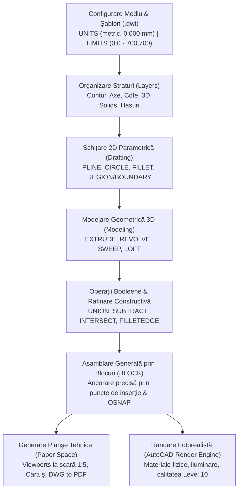

# Memoriu Tehnic de Proiectare și Documentație Constructivă
## Proiect: Espressor Automat de Cafea — Modelare 3D CAD în Autodesk AutoCAD

---

### Date de Identificare Proiect
* **Titlu lucrare:** Proiectare și Modelare 3D a unui Espressor Automat de Cafea
* **Disciplină:** Grafică Asistată de Calculator (CAD)
* **Instituție:** Universitatea din București, Facultatea de Matematică și Informatică
* **Departament:** Departamentul de Calculatoare și Tehnologia Informației (CTI)
* **Autor:** Student Flueraru Alexandru Achille (Grupa 161)
* **Coordonator Științific:** Lector Dr. Drăgan Mihăiță
* **An universitar:** 2025–2026

---

## 1. Tema de Proiectare și Motivație Inginerească

Obiectivul prezentului proiect constă în proiectarea integrală, de la nivel de schiță 2D până la model 3D asamblat complet, a unui **espressor automat de cafea de înaltă performanță**, destinat mediului casnic avansat (prosumer) și micilor spații comerciale.

Ca etalon de design industrial și referință geometrică s-a ales modelul clasic **Rancilio Silvia**, recunoscut mondial pentru fiabilitatea șasiului, arhitectura electromecanică robustă și designul atemporal. Acest reper oferă un echilibru perfect între:
1. **Suprafețe plane și unghiuri drepte:** specifice prelucrării tablei ambutisate și debitate laser (carcasa exterioară și șasiul).
2. **Corpuri de revoluție și curburi complexe:** specifice componentelor turnate și forjate (boiler, grup de extracție, portafiltru, baghetă de abur).
3. **Elemente ergonomice și de interfață utilizator:** comutatoare basculante, butoane rotative striate și indicator optic.

---

## 2. Specificații Funcționale și Parametri Constructivi

| Parametru Tehnic | Valoare Nominală | Justificare / Relație Funcțională |
| :--- | :--- | :--- |
| **Gabarit general (L x l x h)** | $235 \times 290 \times 340\text{ mm}$ | Dimensiuni compacte, optimizate pentru integrarea pe blat ergonomic |
| **Masă totală estimată** | $\approx 14.0\text{ kg}$ | Oferă stabilitate mecanică ridicată în timpul cuplării portafiltrului cu forță de torsiune |
| **Volum Boiler (Cazan)** | $300\text{ ml}$ | Inerție termică ridicată pentru stabilizarea temperaturii la $93^\circ\text{C}$ în regim de extracție |
| **Putere Rezistență Termică** | $1100\text{ W}$ ($230\text{V} / 50\text{Hz}$) | Timp rapid de aducere în regim nominal ($\approx 90\text{ secunde}$) |
| **Presiune Pompă Hidraulică** | $15\text{ bar}$ max (nominal $9\text{ bar}$ la extracție) | Generată de o pompă cu piston oscilant (tip ULKA EP5) cu supapă de suprapresiune OPV |
| **Capacitate Rezervor Apă** | $2.0\text{ litri}$ | Autonomie de circa 40-50 shot-uri de espresso sau 15 cicluri de spumare abur |
| **Diametru Grup Extracție** | Standard profesional $58\text{ mm}$ | Compatibilitate cu accesorii de extracție profesionale (site VST/IMS, tampere de precizie) |
| **Tip Circuit Abur** | Baghetă din inox cu articulație sferică | Mișcare tridimensională la $360^\circ$ și vârf cu micro-orificiu conic pentru texturare microspumă |

---

## 3. Arhitectura Subansamblurilor și Justificarea Materialelor

### 3.1. Șasiul Structural de Rezistență (Subansamblu Cadru)
Șasiul reprezintă coloana vertebrală mecanică a espressorului, proiectat din trei subcomponente asamblate prin îmbinări demontabile și puncte de sudură:
* **Cadru Inferior:** Realizat din tablă de oțel structural ambutisată la rece și vopsită electrostatic în câmp negru (`Anodized - Black`). Baza rigidă preia masa boilerului, vibrațiile pompei hidraulice și ghidajele tăvii de scurgere.
* **Cadru Vertical:** Element structural vertical ce rigidizează coloana aparatului, oferind fante decupate precis pentru traseele electrice, cablaje și izolatori termici.
* **Cadru Orizontal:** Traversa superioară care susține grupul masiv de extracție și oferă punctele de ancorare pentru panoul frontal și cel superior.

### 3.2. Carcasa Exterioară (Panotajul)
* **Material:** Oțel inoxidabil austenitic **AISI 304** (1.4301 / X5CrNi18-10), cu finisaj satinat longitudinal (`Stainless - Satin`).
* **Proprietăți cheie:** Rezistență superioară la coroziune sub influența apei calde și a vaporilor, proprietăți antibacteriene, ușor de igienizat și rezistent la zgârieturi/amprente.
* **Panoul Frontal:** Decupat laser pe mașini CNC pentru integrarea a trei comutatoare basculante (Alimentare, Pompă Cafea, Abur), a lămpii de control și a axului rotativ pentru robinetul de abur.
* **Panoul Anti-Stropire:** Oțel inoxidabil AISI 304 cu finisaj lustruit oglindă (`Stainless - Polished`), poziționat în spatele grupului de extracție pentru protejarea componentelor interne de stropii de cafea și vapori.

### 3.3. Grupul de Extracție și Ansamblul Portafiltru
* **Grupul de Infuzie:** Piese turnată din alamă alimentară CW510L cu conținut scăzut de plumb, prelucrată prin frezare CNC pe 5 axe. Alama oferă o conductivitate termică optimă ($\lambda \approx 115\text{ W/m}\cdot\text{K}$), asigurând menținerea temperaturii optime a apei ($92^\circ\text{C} - 94^\circ\text{C}$) chiar și la contactul cu camera de infuzie rece.
* **Portfiltrul:** Corp masiv forjat din alamă cromată electrolitic (greutate proprie $> 500\text{g}$ pentru stabilitate termică), prevăzut cu canal cu două căi de scurgere și blocare etanșă tip baionetă la $45^\circ$.
* **Mânerul Portafiltrului:** Modelat din rășină fenolică termoizolantă (Bachelită) cu proprietăți de auto-stingere și rezistență la temperaturi de peste $150^\circ\text{C}$, profilat ergonomic cu nervură de sprijin pentru police.

### 3.4. Sistemul de Evacuare și Gestionare a Fluidelor
* **Grătarul de Scurgere:** Tablă de inox de 1.2 mm grosime, ștanțată cu fante eliptice paralele și finisată satinat, care previne acumularea apei la baza ceștilor.
* **Rezervorul de Apă:** Modelat din copoliester alimentar transparent (SAN / Tritan, fără bisfenol A), cu o grosime a peretelui de 2.5 mm și cuplaj inferior etanș cu arc și bilă de reținere.

---

## 4. Metodologia de Modelare Parametrică în Autodesk AutoCAD

Proiectul a fost elaborat respectând etapele metodologice riguroase ale ingineriei grafice:

### 4.1. Configurare Inițială și Standardizare
* **Unități de măsură:** Sistemul metric cu o precizie de trei zecimale (`0.000`), unitatea de inserție setată pe milimetri (`mm`).
* **Spațiul de desenare:** Setat cu comanda `LIMITS` la intervalul `(0,0)` – `(700,700)`, proporționat adecvat pentru gabaritul espressorului.
* **Șablon standardizat:** Toate configurările preliminare au fost salvate în fișierul `sablon.dwt` pentru a asigura unificarea stilurilor de cotare, a fonturilor tehnice (ISO) și a grosimilor de linie.

### 4.2. Structura pe Straturi (Layer Management)
Pentru un control riguros asupra vizibilității și proprietăților grafice, desenul a fost structurat astfel:
* `Contur_Principal` (Culoare: Alb/Negru, Grosime: 0.50 mm) — Geometria exterioară a componentelor.
* `Linii_Ascunse` (Culoare: Gri, Tip: HIDDEN, Grosime: 0.25 mm) — Muchii invizibile în proiecțiile 2D.
* `Axe_Simetrie` (Culoare: Roșu, Tip: CENTER, Grosime: 0.18 mm) — Axe de revoluție și de simetrie.
* `Cote_Tehnice` (Culoare: Cyan, Grosime: 0.25 mm) — Linii și texte de cotare conform SR EN ISO 129-1.
* `Obiect_3D` (Culoare: ByLayer, Grosime: 0.35 mm) — Corpurile solide tridimensionale modelate.
* `Materiale_Randare` — Strat dedicat asignării bibliotecilor de aspect fotorealist.

### 4.3. Tehnici de Modelare 3D a Corpurilor Solide
1. **Extrudare (`EXTRUDE`):** Utilizată pentru piesele din tablă îndoită (cadru inferior, panou frontal, panou spate). Contururile 2D au fost închise riguros în regiuni (`REGION`) sau polilinii continue (`PEDIT -> Join`), apoi extrudate la grosimea tablei ($1.0\text{ mm} - 1.5\text{ mm}$).
2. **Revoluție (`REVOLVE`):** Utilizată pentru piesele axi-simetrice (corpul portafiltrului, sita conică de 58 mm, valva de abur, butoanele rotative). S-a schițat secțiunea axială semi-contur, care a fost rotită cu $360^\circ$ în jurul axei centrale.
3. **Măturare de-a lungul unui traseu (`SWEEP`):** Utilizată pentru realizarea țevii de abur (Steam Wand) și a mânerului ergonomic al portafiltrului. S-a generat o curbă 3D spațială (`Spline` / `Polyline 3D`) ca traiectorie, iar un cerc reprezentând diametrul exterior al țevii a fost măturat de-a lungul acesteia.
4. **Operații Booleene:** Realizarea cavităților interioare prin scădere (`SUBTRACT`), unirea subcomponentelor sudate (`UNION`) și verificarea interferențelor (`INTERSECT`).
5. **Finisări de muchie:** Racordarea marginilor ergonomice prin `FILLETEDGE` (raze între $1\text{ mm}$ și $5\text{ mm}$) și teșirea scaunelor de supapă prin `CHAMFEREDGE`.

---

## 5. Calcule Termohidraulice și Verificări Constructive

### 5.1. Bilanțul Termic de Încălzire a Boilerului
Energia termică $Q$ necesară aducerii apei din boiler de la temperatura rețelei ($T_1 = 20^\circ\text{C}$) la temperatura de extracție ($T_2 = 93^\circ\text{C}$):

$$Q = m \cdot c_p \cdot (T_2 - T_1)$$

Unde:
* $m = \rho \cdot V = 1000\text{ kg/m}^3 \cdot 0.3 \times 10^{-3}\text{ m}^3 = 0.3\text{ kg}$
* $c_p = 4186\text{ J/(kg}\cdot\text{K)}$ (căldura specifică a apei)
* $\Delta T = 93 - 20 = 73\text{ K}$

$$Q = 0.3 \cdot 4186 \cdot 73 = 91\,673.4\text{ J} \approx 91.67\text{ kJ}$$

Timpul teoretic de încălzire $t$ la o putere a rezistenței $P = 1100\text{ W}$, considerând un randament termic $\eta = 0.85$ (datorat inerției corpului din alamă și pierderilor radiative):

$$t = \frac{Q}{\eta \cdot P} = \frac{91\,673.4}{0.85 \cdot 1100} \approx 98.05\text{ secunde} \approx 1\text{ minut și } 38\text{ secunde}$$

Acest rezultat confirmă operabilitatea rapidă și eficiența energetică a soluției alese.

### 5.2. Verificarea Rezistenței la Presiune a Corpului Boilerului
Boilerul funcționează la o presiune nominală de regim de $9\text{ bar}$ ($0.9\text{ MPa}$), cu vârfuri de testare de siguranță de $16\text{ bar}$ ($1.6\text{ MPa}$).
Utilizând relația cazanelor cu pereți subțiri (formula lui Laplace) pentru tensiunea tangențială de întindere $\sigma_t$:

$$\sigma_t = \frac{p \cdot d}{2 \cdot s}$$

Pentru:
* Presiunea de vârf: $p = 1.6\text{ MPa}$
* Diametrul interior mediu al cazanului: $d = 80\text{ mm}$
* Grosimea peretelui din alamă turnată: $s = 4.0\text{ mm}$

$$\sigma_t = \frac{1.6 \cdot 80}{2 \cdot 4.0} = 16.0\text{ MPa}$$

Rezistența admisibilă a alamei sanitare CW510L la cald este $\sigma_{\text{adm}} \ge 120\text{ MPa}$.
Coeficientul de siguranță $c$:

$$c = \frac{\sigma_{\text{adm}}}{\sigma_t} = \frac{120}{16} = 7.5 > 3.0$$

Ansamblul prezintă o marjă substanțială de securitate la presiuni ridicate de lucru.

---

## 6. Layout Tehnic în Paper Space și Randare Fotorealistă

### 6.1. Planșele Tehnice 2D (Paper Space)
* **Standard Plotter:** `DWG To PDF.pc3` cu generare vectorială a liniilor de contur și a textelor.
* **Formatul Paginii:** Format standardizat ISO cu cartuș conform normelor STAS / ISO (titlu, autor, coordonator științific, scară).
* **Scara de Reprezentare:** S-a utilizat scara standardizată **1:5** în ferestrele de vizualizare (`Viewports`), garantând precizia dimensională la printare.
* **Configurația Proiecțiilor:** Proiecții ortogonale (Vedere din Față, Vedere de Sus, Secțiune Laterală) completate de proiecția izometrică axonometrică 3D dinamică.

### 6.2. Motorul de Randare AutoCAD (Rendering Engine)
* **Calitate Render:** Nivel maxim **Level 10**, asigurând eșantionarea riguroasă a razelor de lumină indirectă și eliminarea aberațiilor cromatice pe corpurile lucioase.
* **Mediu Ambiental:** Fundal negru profund (`Black Background`) pentru evidențierea reflexiilor oțelului inoxidabil satinat și a elementelor lustruite oglindă.
* **Timp de Procesare:** 4 minute și 17 secunde pentru calculul deplin al rețelei fotonice.

---

## 7. Conformitate cu Standardele de Calitate și Siguranță Alimentară

Materialele selectate respectă cu strictețe normele europene și internaționale pentru echipamente destinate contactului cu alimentele și băuturile calde:
1. **Regulamentul (CE) Nr. 1935/2004** privind materialele și obiectele destinate să vină în contact cu produsele alimentare.
2. **DIN EN 1982:** Compoziția alamei cu conținut redus de plumb (Lead-Free / CW510L) pentru prevenirea migrației ionilor metalici în apă.
3. **FDA 21 CFR 177.1520:** Polimeri de uz alimentar fără bisfenol A (BPA-Free) pentru rezervorul de apă curată și garniturile siliconice EPDM / FKM alimentare.

---

## 8. Concluzii și Valoare Aplicativă

Proiectul demonstrează capacitatea avansată de proiectare a mediului Autodesk AutoCAD, reușind:
* Integrarea a peste 24 de componente și subansambluri distincte într-o structură coerentă fără interferențe geometrice.
* Generarea unei documentații tehnice complete de execuție, compatibilă atât cu procesele de fabricație convenționale (ambutisare tablă, prelucrări CNC), cât și cu producția aditivă modernă.
